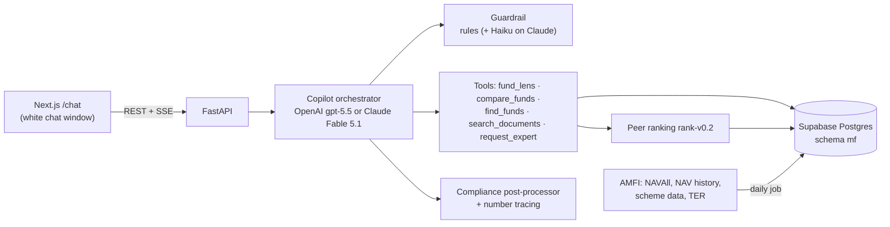

# RA — Rebirth Assistant

A single, clean chat window for Indian mutual funds. Ask about **any fund** and RA answers in a few plain sentences: where it ranks among the other funds in its SEBI category, and how it stands on performance, consistency, risk, diversification, asset mix and cost (the "D-lens"). Built for an AMFI-registered Mutual Fund Distributor, to the PRD + ERD.

---

## What it does

| Area | What it does |
|---|---|
| **Chat** | White, text-only window. Streams answers; a guest is created per browser, and the latest conversation reloads on refresh. |
| **Answers** | One-line verdict, then 3–5 short bullets, under ~120 words, simple words, the "as of" date, and the past-performance caveat. Facts and comparisons, never buy/sell calls. |
| **Fund lens** | For any fund (name or AMFI code): its rank among category peers; each metric beside the category median and quartiles; the D-profile; launch date and minimum investment; the category's top funds. A Direct plan is compared through its Regular-Growth sibling so peers are like for like. |
| **Comparisons** | 2–4 funds side by side, flagging when they're in different categories (ranks then aren't comparable). |
| **Ranking** | `rank-v0.2`, within each SEBI category: 3-year rolling-return consistency vs peers, 3-year Sortino, downside capture, max drawdown and expense ratio → composite score and tier. |
| **Guardrails** | Rules (plus a Claude Haiku classifier on the Claude path) route each message: in scope / out of scope (stocks, F&O, crypto, insurance, loans, FDs) / human expert / prompt injection. |
| **Compliance** | Rewrites banned claims ("guaranteed", "risk-free", adviser language) unless negated; attaches disclosures; logs any number that no tool output supports (`untraced_numbers`). |

### The copilot's tools

The LLM explains; deterministic tools supply every number.

| Tool | Returns |
|---|---|
| `fund_lens` | One fund vs its category: rank, metrics vs median/quartiles, D-profile, facts, top peers |
| `compare_funds` | 2–4 funds' ranks and key metrics with category medians |
| `find_funds` | Fuzzy name search → AMFI code, plan, option, category |
| `search_documents` | Full-text passages from stored official documents (none loaded yet, see below) |
| `portfolio_xray` | Look-through of the investor's own funds from each fund's latest monthly disclosure: top securities, sectors, overlap, concentration, checks against the investor's own limits; their own what-if moves or a low-overlap screen if asked |
| `request_expert` | Opens an expert ticket (free, reply within 1 business day) |

---

## What's in the database

Supabase Postgres, project `pvdbzvkmpbzixfhdrhnx` (ap-southeast-1). All RA tables live in the **`mf` schema**, which Supabase doesn't expose through its REST API. To see them in the Table Editor, pick **`mf`** in the schema dropdown. Counts are as of **16 Oct 2026**.

### Used by the chat

| Table | Rows | Size | What it holds | Source |
|---|---:|---:|---|---|
| `scheme` | 14,377 | 10 MB | Every AMFI scheme code (one per plan + option): name, AMC, raw and normalised SEBI category, plan, option, ISINs, latest NAV, riskometer (category default), `in_universe`, `is_benchmark_proxy` | AMFI NAVAll, daily |
| `nav_history` | 1,747,251 | 125 MB | Daily NAVs, **18 Oct 2019 → 15 Oct 2026**, for the investable universe and the benchmark proxies | AMFI NAV history report |
| `scheme_metric` | 2,081 | 1.8 MB | Per-fund metrics and peer ranking (1/3/5-year returns, rolling consistency, Sortino, volatility, max drawdown, downside capture, beta, R², tracking error, expense ratio → composite score and tier). Current run (15 Oct 2026, `rank-v0.2`): 904 funds in 35 ranked categories, 727 ranked (3+ years of NAVs), 902 with an expense ratio. The 1,131 older `rank-v0.1` rows are ignored by the app | Computed from `nav_history` + `scheme_ter` |
| `category_stat` | 71 | 0.2 MB | Per-category peer distributions (medians, quartiles), so any fund can be placed against its category quickly; 35 categories in the current run | Computed |
| `scheme_detail` | 16,452 | 14 MB | AMC, scheme type and category, launch and closure dates, minimum investment, ISINs, plus the raw source row | AMFI scheme data CSV |
| `scheme_ter` | 148,988 | 62 MB | Total expense ratio, Regular and Direct, with the breakdown (base, brokerage, transaction, statutory, 52(6A)(b)/(c)), for 2,995 schemes, **1 Nov 2023 → 15 Oct 2026**. Stored as change points: a row only when a value changes (1.9 million daily values read) | AMFI TER disclosures |
| `scheme_link` | 9,611 | 1.3 MB | Links each expense-ratio scheme name to its AMFI codes: 2,458 of 2,995 names matched (2,359 exact, 99 fuzzy); 537 unmatched, e.g. names carrying "Formerly known as …" | Computed |
| `chat_session` / `chat_message` | 7 / 14 | <0.1 MB | Conversations: frozen system prompt, prompt version, model, the API transcript, display text, tool calls, guardrail verdicts, compliance flags, untraced numbers | The app |
| `investor` | 9 | <0.1 MB | Chat owners: 8 browser guests and 1 legacy demo investor | The app |
| `escalation` | 0 | — | Human-expert tickets opened from chat | The app |
| `audit_log` | 0 | — | Audit trail (reserved) | The app |

**Investable universe:** 1,639 schemes. That is 1,634 open-ended Regular-plan Growth schemes from 53 AMCs that published a NAV in the last 30 days (ETFs excluded), plus 5 index funds used as benchmark proxies (Nifty 50, Nifty 500, Midcap 150, Smallcap 250, LargeMidcap 250). Largest groups: index equity 260, thematic 235, index debt 103, multi-asset 59, international FoF 52, flexi cap 46, liquid 43, ELSS 38, small cap 36, large & mid cap 36, large cap 35, mid cap 34.

### Created but empty (waiting on a source)

| Table | Why it's empty |
|---|---|
| `document`, `document_chunk` | Official documents (AMFI Code of Ethics, master circular, distributor FAQs, SEBI FAQs, AMFI monthly reports) are held back until legal confirms AMFI's terms of use allow storing them. The loader is ready (`sync-documents`); each document records its `source_terms`. |
| `scheme_performance` | AMFI's fund-performance feed (official benchmark returns, AUM, official riskometer) blocks automated access (HTTP 403), so it isn't scraped. Proposed alternative: AMC monthly disclosures. |
| `scheme_portfolio` | Stock-level holdings (security, ISIN, sector, industry, asset class, weight, value, source) behind the X-ray. Load AMC monthly workbooks with `load-portfolios`. Loaded: Nippon India, PPFAS, DSP, ICICI Pru (Sep 2026) and, from the MIT mirror github.com/subscriptionmanager26-png/fund-disclosures (Aug 2026, sha256 matched to its manifest), SBI, Mirae, Franklin, Baroda BNP, PGIM, JM, Abakkus. Not loaded: HDFC (blocked), Kotak, ABSL, Axis, UTI, Union, Navi (see `portfolio_sources.py`). |

### Legacy tables (no longer used by the code)

The earlier portfolio app left these tables in `mf` holding only demo data: `folio` (5), `holding` (8), `txn` (275), `risk_profile` (1), `goal` (1), `reco_run` (2), `reco_item` (8), `import_job` (1), `consent` (0). They are about 0.5 MB in total and safe to drop:

```sql
DROP TABLE mf.reco_item, mf.reco_run, mf.txn, mf.holding, mf.folio, mf.goal, mf.risk_profile, mf.import_job, mf.consent;
```

The `public` schema still holds the old securities tables: `historical_prices` (189,103 rows, 51 MB), `concalls` (37), `annual_reports` (0) and `analyst_ratings` (0). They were backed up locally before the planned drop:

```sql
DROP TABLE public.historical_prices, public.concalls, public.annual_reports, public.analyst_ratings;
```

**Size:** the whole database is 281 MB, of which `mf` is about 215 MB. The Supabase free tier allows 500 MB.

---

## Portfolio X-ray

Page `/xray` (and the `portfolio_xray` chat tool): enter funds with amounts, optionally your own limits (max single security, sector, industry; names to avoid). It shows exposure by security, sector, industry and asset class, overlap between each pair of funds, concentration (top-10, effective number of stocks), and where a limit you set is exceeded. You can try your own what-if (move ₹X from fund A to B) and list funds with the lowest overlap with your holdings. Maths: `backend/app/analytics/xray.py` (pure functions; exposure E(s) = Σ value × weight, overlap = Σ min(weights)).

Rules it follows: facts and comparisons only, no buy/sell/switch wording (a banned-word test covers every generated string); every number states the fund's disclosure month; the lowest-overlap list is labelled "one criterion, not a recommendation" and never picks one fund; funds without a loaded disclosure are reported as such, never estimated; a human expert (EUIN holder) is offered.

### Holdings coverage (467 of 1,640 investable funds, 12 of 53 AMCs; local DB)

| AMC | Funds | Month | Source |
|---|---|---|---|
| ICICI Prudential | 113 | Sep 2026 | AMC file, plain download (sha256 matches the manifest in the mirror repo) |
| SBI | 86 | Aug 2026 | Mirror copy, not independently verifiable (robots.txt disallows automated download) |
| Nippon India | 75 | Sep 2026 | AMC file |
| DSP | 65 | Sep 2026 | AMC file |
| Mirae Asset | 59 | Aug 2026 | Mirror copy, not independently verifiable |
| Baroda BNP Paribas | 43 | Aug 2026 | Mirror copy |
| Franklin Templeton | 33 | Aug 2026 | Mirror copy (5 quarantined) |
| PGIM India | 23 | Aug 2026 | Mirror copy (one fund removed: file carried a 2022 date) |
| JM Financial | 17 | Aug 2026 | Mirror copy |
| PPFAS | 7 | Sep 2026 | AMC file |
| Abakkus | 4 | Aug 2026 | Mirror copy |
| UTI | 1 | Sep 2026 | One fund only (ULIP) |

"Mirror" = github.com/subscriptionmanager26-png/fund-disclosures (MIT; AMC-direct files, every file's sha256 checked against its manifest; two re-downloaded from the AMC and matched byte for byte). Weights sum to 90-110% for all but 3 DSP funds (arbitrage and hedged funds net short futures). Fund-level checks: ISIN length, weights, quarantine of bad rows.

**Leftovers (not loaded)**

| What | Why | Next step |
|---|---|---|
| HDFC (83 funds) | Site blocks automated requests (Akamai); we do not work around it | Download the monthly file by hand, then `load-portfolios` |
| Kotak (93), Aditya Birla SL (84), Axis (73), Bandhan (68), Tata (58), others | No automated path found; not in any repo we checked | Download by hand (page URLs in `portfolio_sources.py`) or ask the AMC's distributor desk |
| UTI (69), Union, Navi | UTI: mirror file holds exposure sheets, not holdings; Union: loader links 0 of 32 files; Navi: mirror hashes do not match its manifest | Find UTI's scheme file; add a layout rule for Union; re-fetch Navi from the AMC |
| ~35 ICICI ETFs and other ETFs | No Regular-Growth plan to attach holdings to | Link by ETF code if ETFs enter the universe |
| Index funds (~260) | Holdings equal the index constituents | Load NSE/BSE constituent files after checking their terms |
| Month mix | Aug 2026 for mirror AMCs, Sep for the rest | Re-run the loaders on September files; each fund shows its own month |
| Supabase | **Done 2026-10-22:** 31,410 rows, 526 fund portfolios (Aug and Sep 2026) loaded with `push-holdings --apply`; the 6 new columns were added to `mf.scheme_portfolio` (additive). Re-run after each monthly load; it replaces each fund-month, so it is safe | Keep it current: monthly load, then `push-holdings --apply` |

Sources and per-AMC notes: `backend/app/data/portfolio_sources.py`.

## Architecture



- **Providers:** `COPILOT_PROVIDER=openai` (current) uses Chat Completions with streamed tool calls and `reasoning_effort="none"` (gpt-5.x rejects function tools with reasoning on that API). `anthropic` uses Claude Fable 5.1 with adaptive thinking, refusal fallbacks (`server-side-fallback-2026-07-01`), an append-only transcript and `drop_block` thinking binding (`thinking-binding-controls-2026-08-01`). Each session keeps the model it started with.
- The system prompt is versioned (`ra-prompt-v2`) and frozen per session; every turn stores model, prompt version, tool calls and guardrail results.

---

## Quick start

Requirements: Python 3.12 + [uv](https://docs.astral.sh/uv/), Node 20+.

```bash
# Backend
cd backend
uv sync
cp .env.example .env                          # OPENAI_API_KEY (or ANTHROPIC_API_KEY); DATABASE_URL for Supabase
uv run python -m app.cli sync-schemes         # AMFI scheme master + today's NAVs
uv run python -m app.cli sync-history         # 6 years of NAVs (first time only, ~10 min)
uv run python -m app.cli sync-scheme-details  # launch dates, minimums
uv run python -m app.cli sync-ter             # expense ratios, last 36 months
uv run python -m app.cli compute-metrics      # peer rankings
uv run uvicorn app.main:app --port 8000

# Frontend (new terminal)
cd frontend
npm install
cp .env.example .env.local
npm run dev                                   # http://localhost:3000/chat
```

Without an API key the chat says it isn't connected.

### Supabase

1. Dashboard → **Connect → Session pooler**: copy the URI (IPv4, port 5432). The direct `db.<ref>.supabase.co` host is IPv6-only.
2. Set it as `DATABASE_URL` in `backend/.env`. Tables are created on startup in `DB_SCHEMA` (`mf`). `backend/sql/schema.sql` shows the DDL.
3. Daily refresh: add `DATABASE_URL` as a GitHub repository secret. `.github/workflows/daily-data.yml` then runs `python -m app.cli daily` at 23:45 IST on weekdays.

### CLI (`uv run python -m app.cli …`)

| Command | Purpose |
|---|---|
| `sync-schemes` | AMFI scheme master + today's NAVs; rebuilds the investable universe |
| `sync-history [--years N]` / `repair-history` / `backfill-missing` | NAV history: bulk load, re-fetch gaps, fill schemes with little history |
| `sync-scheme-details` | Launch dates, minimum investment, ISINs |
| `sync-ter [--months N]` | Expense ratios (change points) |
| `compute-metrics` | Rank every peer-group category |
| `daily` | All daily feeds, gap repair, universe refinement, rankings |
| `sync-documents` / `search-docs "QUERY"` | Official documents (held for legal) / full-text search |
| `load-disclosures FILE.csv` | AMC portfolio disclosures → stock-level holdings |
| `push-holdings [--apply]` | Local holdings → Supabase. Dry run unless `--apply`; adds the missing columns (never drops), replaces each fund-month portfolio in one transaction, so re-runs are safe. Needs `SUPABASE_DATABASE_URL` (session pooler URI) in `backend/.env.supabase` (git-ignored). Source links become the AMC's public page, never a local path |
| `load-portfolios PATH_OR_URL [...]` | AMC monthly portfolio workbooks (.xls/.xlsx/.zip, any layout) → holdings under each scheme's Regular-Growth code; reports quarantined and unmatched schemes |
| `stats` / `print-ddl` | Data counts / Postgres DDL |

### API

`POST /api/investors` (guest) · `GET /api/investors/{id}` · `GET|POST /api/investors/{id}/chat/sessions` · `GET|POST /api/chat/sessions/{id}/messages` (POST streams SSE: `status`, `text`, `done`, `error`) · `GET /api/meta/data-status` · `GET /api/health/ready` (data freshness) · `POST /api/portfolio/{xray,simulate,screen}` · `GET /api/funds/search?q=` · `/api/admin/*` (sync jobs, `ADMIN_TOKEN`).

---

## Tests and evals

```bash
cd backend && uv run pytest -q                       # offline, on a synthetic market
cd frontend && npm run typecheck && npx eslint .
cd backend && uv run python ../evals/run_evals.py    # real LLM calls: costs money
```

`evals/golden_set.jsonl` has 32 prompts across factual, comparison, documents, refusal, adversarial and escalation buckets. Deterministic graders check the guardrail route, required and forbidden tools, forbidden text, compliance flags, untraced numbers and escalation tickets. Release gate: ≥90% overall, 100% on refusals and escalations.

---

## Next

| Next | Why |
|---|---|
| Holdings for the leftovers above and a monthly refresh job (SEBI requires disclosure within 10 days of month-end), then `push-holdings --apply` | Wider X-ray coverage |
| AUM and official riskometer | Fills the blocked performance feed |
| CAS upload (casparser) | Funds and units without typing |
| Load official documents once legal clears AMFI's terms | `search_documents` answers on rules with citations |
| Sign-in (Supabase Auth phone OTP) | Guests today; chats tied to a browser |
| Eval set to 150 prompts; weekly human review sample | PRD release gate |

---

The chat runs at `http://localhost:3000/chat` (`/` redirects there). The earlier portfolio, RA Score and suggestions app is preserved at git tag `full-mvp-v1`.

Repository: `backend/` (FastAPI, data loaders, analytics, copilot, CLI, tests) · `frontend/` (Next.js chat) · `evals/` (golden set + runner) · `.github/workflows/` (CI, daily data).

Mutual Fund investments are subject to market risks, read all scheme related documents carefully.
