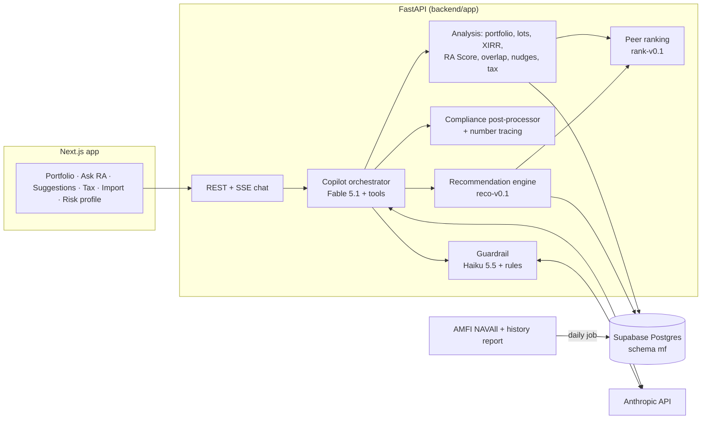

# RA — Rebirth Assistant

An AI mutual-fund companion for Indian investors. Import every fund you own from one CAS statement, see an explainable **RA Score**, get suitability-checked suggestions with tax-aware sequencing, and ask **RA** (powered by Claude Fable 5.1) anything about your portfolio. Built to the [PRD + ERD](#context) for an AMFI-registered Mutual Fund Distributor.


## What's in the MVP

| Area | What it does |
|---|---|
| **Data** | AMFI scheme master (14k+ schemes, both old and 2026 SEBI category labels) + daily NAVs; 6 years of NAV history for the investable universe (~1,630 open-ended Regular-Growth schemes, ETFs excluded) from AMFI's own history report, with gap detection/repair. Supabase Postgres (`mf` schema) or local SQLite. |
| **Import** | CAMS/KFintech CAS PDF via `casparser`, parsed in memory; password never stored; PAN cross-check blocks someone else's statement; ISIN→AMFI mapping with an exceptions list. |
| **Analytics** | Value, invested, gain, XIRR (portfolio and fund), look-through allocation (hybrids split into equity/debt/gold), FIFO tax lots, SIP detection, overlap (disclosure-based when loaded). |
| **Fund ranking** | Within each SEBI category: 3-yr rolling-return consistency vs peers, 3-yr Sortino, downside capture and max drawdown → Core / Satellite / Watch / Exit tiers (`rank-v0.1`). |
| **RA Score** | Six explainable dimensions (below), each with a one-line reason and what would raise it. Dimensions without data say "not scored" instead of guessing. |
| **Recommendations** | Diagnosis rules → action cards (switch, redirect SIP, STP, start SIP, review) behind a suitability gate, with tax and exit-load estimates and "wait until DATE" sequencing. Rules coordinate: money leaving an unsuitable equity fund goes to the under-weight asset when equity is already over its band. No fund suggestions without a risk profile. Every run is persisted and reproducible. |
| **Copilot** | Claude Fable 5.1 with 12 deterministic tools; Haiku 5.5 guardrail classifier; compliance post-processor; number tracing; human-expert escalation; full audit trail. |
| **Proactive nudges** | Lots turning long-term soon, exit-load windows ending, ELSS unlocks, missed SIPs, laggards, idle cash, drift, LTCG harvesting window (Jan–Mar), risk profile due. |
| **Goals** | Goal-based SIP maths with cautious/base/optimistic assumptions (labelled as assumptions, never predictions). |
| **Web app** | Next.js 16 PWA-ready UI: onboarding, portfolio, Ask RA (streaming), suggestions, tax, CAS import, risk profile. Light and dark themes; lakh/crore formatting; compliance footer everywhere. |

### RA Score dimensions

Six explainable dimensions, each with a one-line reason and what would raise it:

| RA dimension (weight) | Measures | Notes |
|---|---|---|
| Discipline (15) | Months invested, SIP continuity, missed instalments | Continuity of investing |
| Balance (20) | Equity/debt/gold vs the **investor's own** risk-profile bands | Personalised to the investor's risk profile |
| Risk fit (20) | Share of money in funds suitable for the profile | Suitability |
| Diversification (15) | Fund/AMC/sector concentration, clutter, overlap | Concentration |
| Performance (20) | **Your actual cashflows replayed into the benchmark index fund** (alpha in XIRR), plus peer tiers | On real money in and out, not point-to-point returns |
| Efficiency (10) | Idle cash, short-term churn, IDCW tax drag | New |

---

## Architecture



**The LLM explains, the engines decide** (PRD §10.1): every number comes from a tool, scheme suggestions come only from the engine, and the model never sees name, PAN or phone.

### Copilot (Claude Fable 5.1) — implementation notes

- `claude-fable-5-1` for reasoning and tool use; `claude-haiku-5-5` for the guardrail/intent classifier (structured JSON output). Both are configurable (`COPILOT_MODEL`, `GUARDRAIL_MODEL`); effort defaults to `medium` for chat latency.
- **Refusal fallbacks are on** (`fallbacks: "default"`, beta `server-side-fallback-2026-07-01`): if Fable's safety classifier declines a request, the API reroutes it to a fallback model in the same call. Disable with `COPILOT_REFUSAL_FALLBACKS=false`.
- **Append-only transcripts** (Fable 5.1 "preserved thinking"): each session freezes its system prompt; every assistant turn is stored exactly as returned (thinking blocks + signatures) and replayed verbatim; tools are a fixed, ordered list. Compliance edits only touch the separately stored display text. `prefix_mismatch_behavior: "drop_block"` (beta `thinking-binding-controls-2026-08-01`) degrades gracefully after deploys that change tools.
- Prompt caching on the static system prompt + tools; eager tool-input streaming with pydantic validation; tools are bound server-side to the signed-in investor.
- Guardrail routes: in scope / out of scope (stocks, F&O, crypto, insurance, loans, holistic planning) / escalate (human request, complaint, distress, large redemption → expert ticket) / prompt injection. Rules are a floor the model can't downgrade.
- Post-processor: rewrites/flags banned claims ("guaranteed returns", "risk-free", adviser/planner language) unless negated, attaches disclosures, and records any number in the answer that no tool output supports (`untraced_numbers`) for audit and evals.

---

## Quick start

Requirements: Python 3.12 + [uv](https://docs.astral.sh/uv/), Node 20+.

```bash
# Backend
cd backend
uv sync
cp .env.example .env                 # add ANTHROPIC_API_KEY; DATABASE_URL for Supabase (optional)
uv run python -m app.cli sync-schemes        # AMFI scheme master + today's NAVs (~10 s)
uv run python -m app.cli sync-history        # 6 years of NAVs from AMFI (~10 min, first time only)
uv run python -m app.cli compute-metrics     # peer rankings for every category (~10 s)
uv run uvicorn app.main:app --reload --port 8000

# Frontend (new terminal)
cd frontend
npm install
cp .env.example .env.local
npm run dev                                   # http://localhost:3000
```

Open http://localhost:3000 and choose **Explore with a demo portfolio** (built from real NAVs), or import your own CAS. Without `ANTHROPIC_API_KEY` everything works except the chat, which says it isn't connected.

### Supabase

1. In the Supabase dashboard: **Connect → Session pooler** and copy the URI (IPv4-friendly, port 5432).
2. Put it in `backend/.env` as `DATABASE_URL=...`. Tables are created on first start inside the `mf` schema (`DB_SCHEMA`), which Supabase doesn't expose through its REST API. `backend/sql/schema.sql` shows the DDL.
3. Run the three data commands above once against Supabase (~150–200 MB for 6 years of history; fits the free tier).
4. For daily refreshes, add `DATABASE_URL` as a GitHub repository secret: `.github/workflows/daily-data.yml` runs `python -m app.cli daily` at 23:45 IST on weekdays (run it manually with **backfill** ticked for the first load).

> PRD §12 requires investor PII to be stored in India. For real users, use a Supabase project in `ap-south-1` (Mumbai); moving is just a new `DATABASE_URL`.

### CLI

| Command | Purpose |
|---|---|
| `sync-schemes` | AMFI scheme master + today's NAVs; refreshes the investable universe |
| `sync-history [--years N]` | Bulk NAV history from AMFI's report, month by month |
| `repair-history` | Re-fetch months that came back empty or partial; drop stray rows |
| `compute-metrics` | Rank every peer-group category (tiers, composite scores) |
| `daily` | `sync-schemes` + `repair-history` + `compute-metrics` |
| `create-demo` | Demo investor with real-NAV transactions, risk profile and a goal |
| `load-disclosures FILE.csv` | AMC monthly portfolio disclosures → stock-level overlap and sector exposure |
| `stats` / `print-ddl` | Data counts / Postgres DDL |

---

## Tests and evals

```bash
cd backend && uv run pytest -q        # 32 offline tests: tax rules, FIFO, XIRR, SIPs, CAS import, score, engine, API, copilot loop
cd frontend && npx tsc --noEmit && npx eslint .
```

`evals/` holds the golden set (40 prompts across factual, recommendation, refusal, adversarial and escalation buckets; PRD target 150) and a runner with deterministic graders: guardrail route, required/forbidden tools, forbidden text, compliance flags, untraced numbers, escalation tickets. Release gate: ≥90% overall and 100% on refusals and escalations.

```bash
cd backend && uv run python ../evals/run_evals.py          # real API calls: costs money
```

---

## Compliance guardrails built in

- Product and AI copy avoid "adviser/advisory/planner/financial planning/guaranteed/free portfolio review"; the persona is an AI *guide* under the distributor's ARN.
- Risk profiling is mandatory before fund suggestions; every card passes the suitability gate (REC-6) and carries EUIN, data date, expiry and disclosures.
- MF market-risk disclaimer, AI disclosure, commission disclosure and the ARN tagline appear on every screen.
- PAN is Fernet-encrypted with an HMAC lookup hash and shown masked; CAS PDFs and passwords are never stored; the LLM receives pseudonymous portfolio data only.
- Audit: chat turns store model, prompt version, tool calls, guardrail verdicts, compliance flags and untraced numbers; recommendation runs store inputs and versions.

---

## Known gaps → roadmap

| Next | Why |
|---|---|
| OTP sign-in (Supabase Auth phone OTP) + RBAC; admin/compliance console | Today the investor is chosen in the browser (local/demo use only) |
| Mock → live BSE StAR MF execution: lumpsum, SIP, switch, redeem, EUIN tagging, execution-only acknowledgement, OTP confirm | Act on a card in one tap (PRD §9.5) |
| TER, AUM, fund-manager tenure and SID exit loads/riskometers from a data vendor | Fills the three unavailable ranking factors and replaces category-default riskometers/exit loads |
| AMC monthly portfolio disclosures for the top 100 schemes | Real stock overlap and sector concentration in Diversification |
| Expert desk: EUIN-holder review queue for escalations and flagged chats | "Your expert always has the last word" |
| Email-forward CAS import, NSDL/CDSL CAS, monthly re-import nudges | Lower import friction |
| Push/email/WhatsApp nudges (DLT), Hindi, voice | Proactive reach |
| Eval set to 150 prompts; weekly human review sample | PRD release gate |

What already stands out: cashflow-replay alpha instead of point-to-point returns; coordinated, tax-sequenced cards ("wait until 21 May 2027 to avoid short-term tax"); LTCG exemption tracking and harvesting; a score that says when it can't see enough data; number tracing on every AI answer.

---

## Context

- PRD: `MF-Platform-PRD/PRD + ERD - MF Distribution and AI Copilot Platform.md` (team workspace).
- Repository layout: `backend/` (FastAPI, SQLAlchemy, analytics, engine, copilot, CLI, tests) · `frontend/` (Next.js app) · `evals/` (golden set + runner) · `.github/workflows/` (CI, daily data).

Mutual Fund investments are subject to market risks, read all scheme related documents carefully.
